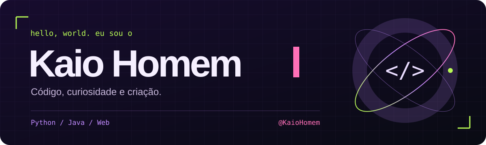

  

---

## Um pouco de mim

- 💻 Sou **Kaio Felipe Homem**, estudante de **Ciência da Computação no IFSC — Lages, SC**.
- 🚀 Busco oportunidades de estágio em **desenvolvimento de software, web ou suporte de TI**.
- 🐍 Entre meus projetos estão aplicações em **Python**, **Java** e **JavaScript**.
- 🌐 Crio também interfaces web com **HTML e CSS**.
- 🔗 Confira meu [portfólio](https://kaiohomem.github.io) e os projetos abaixo.

<b>🇺🇸 English</b>

 

- 💻 I'm **Kaio Felipe Homem**, a **Computer Science student at IFSC — Lages, Brazil**.
- 🚀 Open to internships in **software development, web or IT support**.
- 🐍 My projects include applications built with **Python**, **Java** and **JavaScript**.
- 🌐 I also create web interfaces with **HTML and CSS**.
- 🔗 Explore my [portfolio](https://kaiohomem.github.io) and the projects below.

---

## Minha caixa de ferramentas

### No código

### No fluxo

### No radar

---

## Ideias que viraram projeto

| Projeto | Descrição | Tecnologias |
| --- | --- | --- |
| [ChatDeConversa](https://github.com/KaioHomem/ChatDeConversa) | Aplicativo de chat com múltiplos protocolos. | Python |
| [Guia da Serra](https://github.com/KaioHomem/guia-da-serra) | Guia turístico acessível e responsivo de Lages e da Serra Catarinense. | HTML, CSS, JavaScript |
| [CrudHibernate](https://github.com/KaioHomem/CrudHibernate) | Repositório de projeto em Java. | Java |
| [Portfólio](https://kaiohomem.github.io) | Meu espaço na web. | JavaScript |

---

## Bora trocar uma ideia?

&nbsp;&nbsp;

&nbsp;&nbsp;

 

Feito de curiosidade. Construído em commits.

