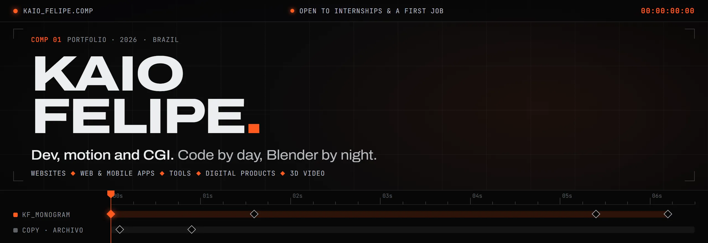
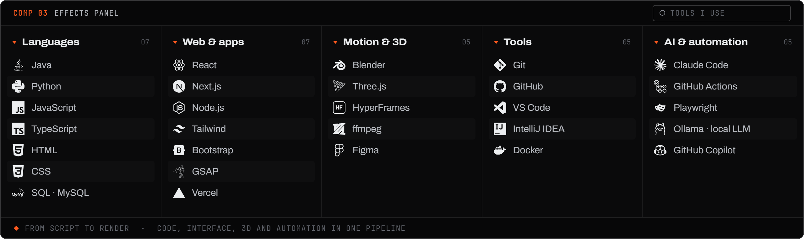

<a href="https://kaiohomem.github.io">
  <picture>
    <source media="(prefers-reduced-motion: reduce)" srcset="assets/banner-still.png">
    
  </picture>
</a>

<code>COMP 01</code> &nbsp;·&nbsp; <code>00:00:00:00</code> &nbsp;◆

## About me

I'm Kaio, a 19-year-old **Computer Science student at IFSC** (Federal Institute of Santa Catarina) in Brazil. I build things that actually work, from the first line of code to the final frame: code by day, Blender by night.

In practice, that means **websites and landing pages**, **web and mobile apps**, **tools and automations**, **digital products**, and **motion and 3D videos**. I like taking an idea all the way to production, with a polished interface, tests and a real deployment.

I speak **English at C1 level** and I'm learning German. I'm looking for an **internship or my first job** in software development, motion design, or both.

<i>PT · Estudante de Ciência da Computação no IFSC. Faço sites, apps web e mobile, ferramentas, produtos digitais e vídeos com motion e 3D. Aberto a estágio e primeiro emprego.</i>

 

<code>COMP 02</code> &nbsp;·&nbsp; <code>00:00:01:16</code> &nbsp;◆

## Selected work

| | Project | What it is | Stack |
| :-- | :-- | :-- | :-- |
| `01` | **[Ferramentas BR](https://kaiohomem.github.io/ferramentas/)** | Eleven Brazilian payroll calculators (net salary, severance, vacation pay, 13th salary, employee vs. contractor) on the 2026 tax tables. A pure calculation engine, tested in CI on every change. | JavaScript · GitHub Actions |
| `02` | **[Folha Simples](https://kaiohomem.github.io/produtos/folha-de-pagamento.html)** | An offline payslip and payroll generator, sold as a digital product. It ships the same engine as the calculators. | JavaScript · Offline |
| `03` | **[Guia da Serra](https://kaiohomem.github.io/guia-da-serra/)** | A responsive, accessible travel guide to Lages and the Santa Catarina highlands, in plain HTML, CSS and JavaScript. | HTML · CSS · A11y |
| `04` | **[ChatDeConversa](https://github.com/KaioHomem/ChatDeConversa)** | A group chat over UDP multicast with a WhatsApp-style Tkinter interface, plus file transfer and IoT modules. | Python · Sockets |

**Motion & CGI.** I also make After Effects–style videos: 3D shots rendered in Blender by script, edited in HyperFrames, with sound design in Python. The monogram at the top of this page came out of that pipeline.

 

<code>COMP 03</code> &nbsp;·&nbsp; <code>00:00:03:08</code> &nbsp;◆

## Effects panel

 

<code>COMP 04</code> &nbsp;·&nbsp; <code>00:00:05:00</code> &nbsp;◆

## Let's build something

My full portfolio, with projects, background and contact, is live:

[LinkedIn](https://www.linkedin.com/in/kaio-homem/) &nbsp;·&nbsp; [kaiokateto@gmail.com](mailto:kaiokateto@gmail.com) &nbsp;·&nbsp; [Portfolio source](https://github.com/KaioHomem/KaioHomem.github.io)

 

<code>END</code> &nbsp;·&nbsp; <code>00:00:06:12</code> &nbsp;·&nbsp; render complete
